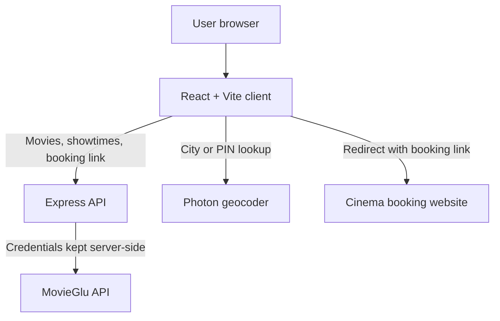
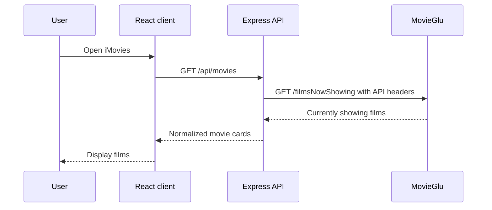
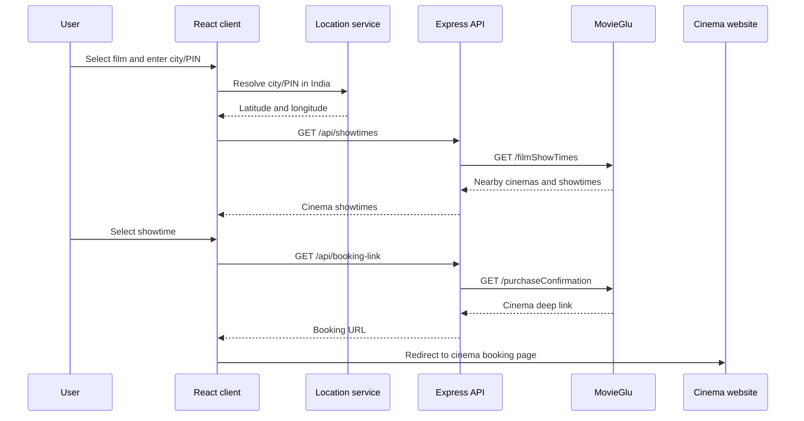

# IMovies

A React cinema-discovery app for films currently showing, nearby cinema showtimes, and hand-off to each cinema’s booking website. It uses a client–server design so MovieGlu credentials remain on the Express server.

> MovieGlu provides showtimes and booking deep links. It does **not** provide seat maps, payments, or on-platform ticket purchasing.

## Stack

| Layer      | Technology                       | Purpose                                                          |
| ---------- | -------------------------------- | ---------------------------------------------------------------- |
| Client     | React, Vite, Tailwind CSS, Axios | Responsive interface and API calls                               |
| Server     | Express, Axios, CORS, dotenv     | Secure proxy for MovieGlu                                        |
| Movie data | MovieGlu                         | Now-showing films, film-specific nearby showtimes, booking links |
| Location   | Photon / OpenStreetMap           | Converts an Indian city or PIN code to latitude/longitude        |

## Architecture



## How it works

### 1. Discover films



### 2. Find showtimes and continue booking



## Project structure

```text
IMovies/
├── client/                 # React/Vite frontend
│   ├── src/
│   │   ├── components/     # Header, hero, catalogue, booking modal
│   │   ├── services/api.js # Client API functions
│   │   ├── App.jsx         # Application state and composition
│   │   └── styles.css      # Tailwind entry/theme tokens
│   └── .env.example
├── server/                 # Express MovieGlu proxy
│   ├── index.js            # API routes and MovieGlu request headers
│   └── .env.example
└── README.md
```

## Setup

### Prerequisites

- Node.js 20+ recommended
- MovieGlu credentials

### 1. Configure the server

```sh
cd server
npm install
```

Copy `server/.env.example` to `server/.env`, then set the MovieGlu values:

```env
PORT=5000
CLIENT_ORIGIN=http://localhost:5173
MOVIEGLU_BASE_URL=https://api-gate2.movieglu.com
MOVIEGLU_CLIENT=...
MOVIEGLU_API_KEY=...
MOVIEGLU_AUTHORIZATION=Basic ...
MOVIEGLU_TERRITORY=IN
MOVIEGLU_API_VERSION=v201
```

Start the API:

```sh
npm run dev
```

### 2. Configure the client

```sh
cd client
npm install
```

Copy `client/.env.example` to `client/.env`:

```env
VITE_API_URL=http://localhost:5000/api
```

Start the client:

```sh
npm run dev
```

Open the Vite URL, normally `http://localhost:5173`.

## API routes

| Route                                                 | Purpose                                                  |
| ----------------------------------------------------- | -------------------------------------------------------- |
| `GET /api/movies`                                     | Returns films currently showing from MovieGlu            |
| `GET /api/showtimes?filmId=&lat=&lon=&date=`          | Returns nearby cinemas and showtimes for a selected film |
| `GET /api/booking-link?cinemaId=&filmId=&date=&time=` | Returns MovieGlu’s cinema booking deep link              |

## Credentials and security

- Store MovieGlu credentials only in `server/.env`.
- Do not expose MovieGlu values through `VITE_*` variables; those are bundled into browser code.
- Keep `.env` files out of source control. The root `.gitignore` already excludes them.
- The supplied MovieGlu sandbox is intended for development/testing and may have limited or synthetic coverage.

## Current limitations

- MovieGlu ultimately redirects users to a cinema’s site; payment and seats occur there.
- Showtimes depend on MovieGlu coverage for the configured territory and location.
- The app currently has no persisted user accounts, bookings, watchlists, or payments.
- Location resolution uses free community geocoding; use a production-grade, rate-limit-compliant location provider when scaling.

## Validation

```sh
cd client && npm run build
cd ../server && node --check index.js
```
